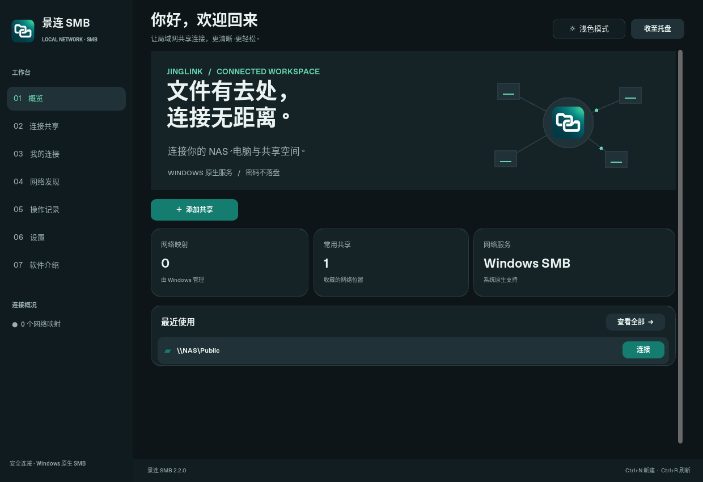
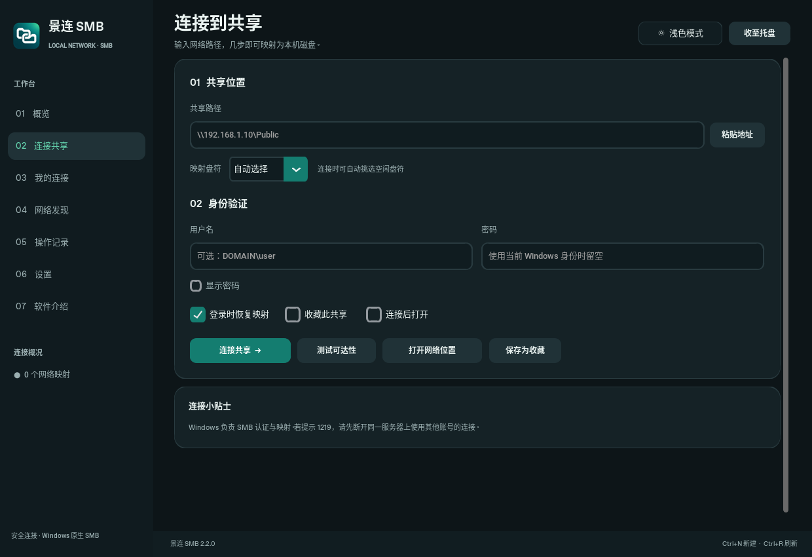
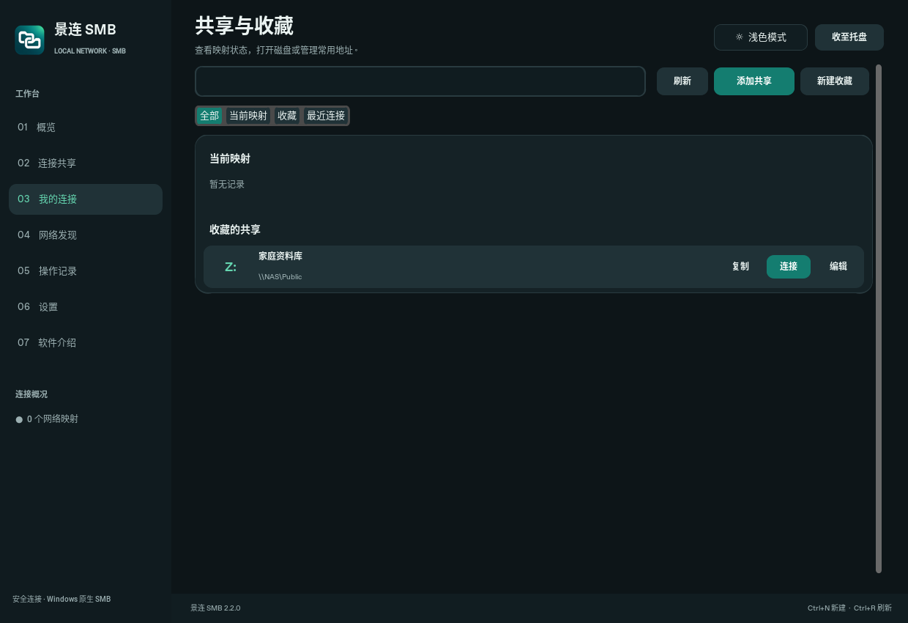
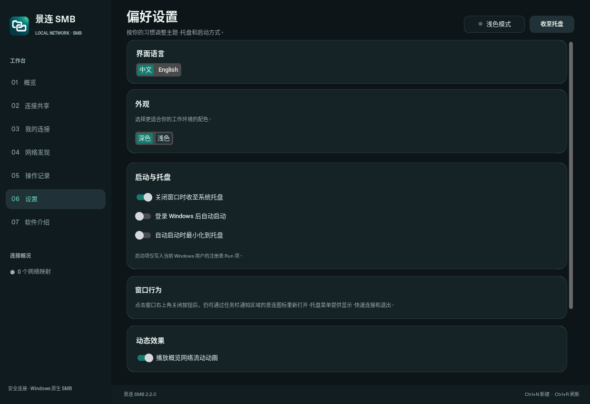
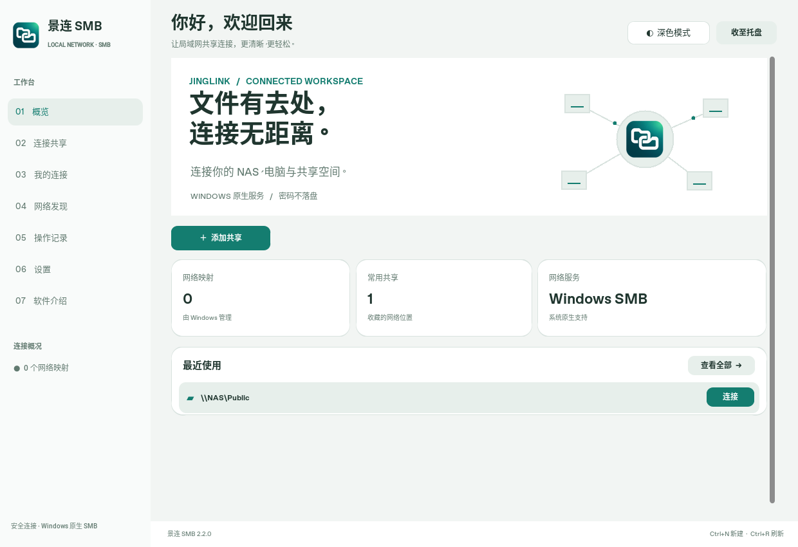
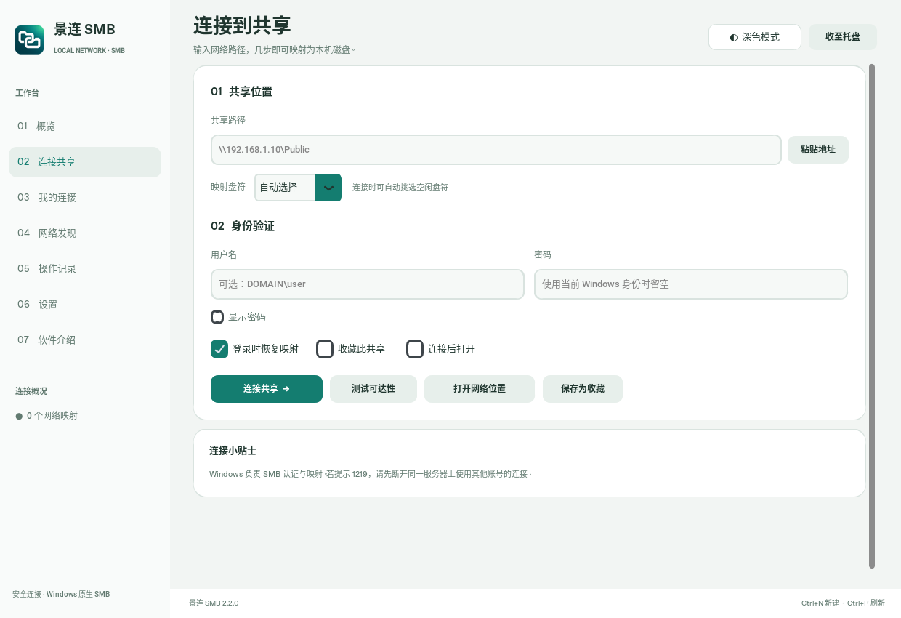
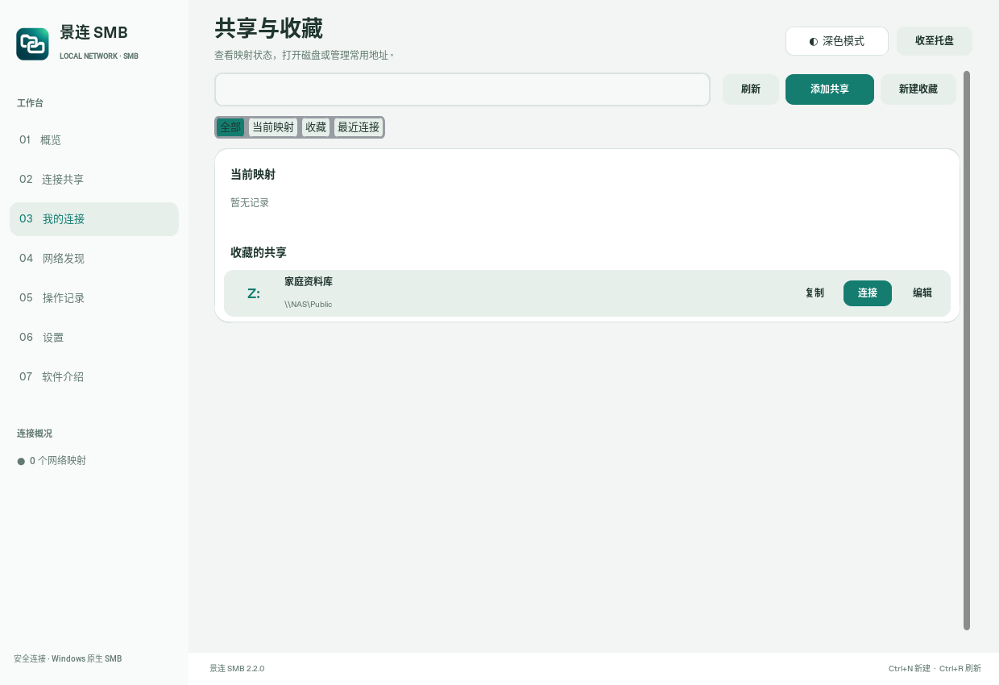
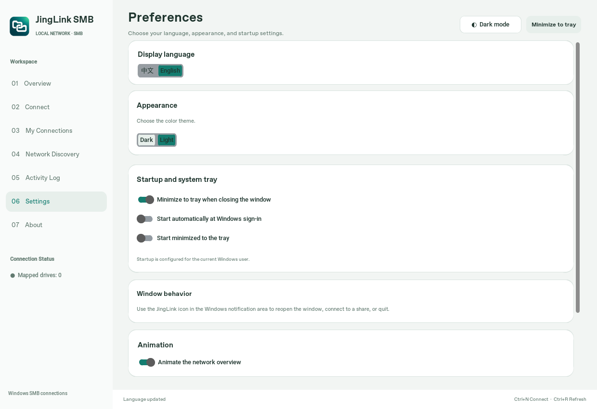

# JingLink SMB · Studio 2.2

A desktop network-share manager for Windows 10 / 11. Connect to NAS devices, home computers and office file servers, and map them as Windows drive letters — all through the native Windows SMB interface. No fake online status, no placeholder buttons.

[](../../releases)
[](#download)
[](https://www.python.org/)

## Download

Grab the latest build from the [**Releases**](../../releases) page:

| File | Type |
|---|---|
| `JingLink-SMB-2.2-x64.exe` | Portable single-file executable (Python runtime built in, just double-click) |
| `JingLink-SMB-2.2-Setup-x64.exe` | Per-user installer with desktop / Start-menu shortcuts and uninstaller |

Both executables are unsigned — SmartScreen may ask for confirmation on first run. Before upgrading, quit the old version from the system tray. New versions use the same user profile directory and will read your existing favorites.

## Highlights

- **Share mapping** — UNC address validation, free drive-letter picking, optional credentials (with password visibility toggle), persistent reconnection at logon.
- **Connectivity diagnostics** — hostname resolution, TCP 445 reachability test with connection timing, one-click copy of the diagnostic report. Port reachability is never presented as a successful authentication.
- **Mapped-drive list** — read through `WNetGetConnectionW`, including broken persistent mappings; refreshed in the background without blocking the UI.
- **Favorites** — create, edit, search and filter; copy addresses; one-click fill into the connect form. Works even while the share is offline.
- **Recent connections** — records only genuinely successful connections; clearable.
- **Device discovery** — scans a chosen IPv4 /24 subnet with live progress, stop button and background scanning.
- **Favorites import / export** — JSON import with structure validation, size limits and de-duplication.
- **Activity log** — up to 200 entries per session, exportable as text.
- **System tray** — closing the window minimizes to tray; tray menu offers show, quick connect, refresh and quit.
- **Auto-start** — optional per-user Run-registry entry, with quiet background start.
- **Shortcuts** — `Ctrl+N` new connection, `Ctrl+R` refresh, `Ctrl+F` search, `Esc` stop scan.
- **Bilingual UI** — Chinese / English switchable in Settings; the choice persists.
- **Theming** — deep-teal dark theme and mist-white light theme, persisted; connection form state is kept when switching.

## Screenshots

| Overview | Connect |
|---|---|
|  |  |
| **My Connections** | **Settings** |
|  |  |

Light theme:

| Overview | Connect |
|---|---|
|  |  |
| **My Connections** | **Settings (English)** |
|  |  |

## Run from source

Requires Windows and Python 3.10+ (3.12 recommended):

```powershell
python -m pip install -r requirements.txt
python smb-connect.py
```

Build both distributables (portable EXE + installer):

```powershell
powershell -ExecutionPolicy Bypass -File .\build.ps1
```

Artifacts are written to `outputs/`. Both are console-less builds that bundle the PNG/ICO assets and the Python runtime.

## Tests

```powershell
python -m pip install pytest
python -m pytest tests -q
python tests/ui_smoke.py
```

UI tests never connect to real servers, scan the network or change auto-start settings; they use an isolated temporary profile and stubbed Windows interfaces.

## Project structure

| File | Purpose |
|---|---|
| `smb-connect.py` | Entry point, Windows mapping interface and shared UI primitives |
| `studio.py` | New pages, interactions, threaded message queue and tray behavior |
| `core.py` | Share / drive validation, config persistence, mapped-drive reading |
| `localization.py` | Chinese / English string table |
| `setup.py` | Branded installer UI, install and uninstall logic |
| `assets/` | Brand icon (PNG / multi-size ICO) |
| `previews/` | Real running screenshots (NAS addresses are demo data) |
| `tests/` | Regression tests and UI smoke script |

## Privacy

Configuration lives in `%APPDATA%\JingSMB\connections.json`. Passwords stay in memory for the current connection only — they are never written to config or export files. Windows' own credential cache is managed by the operating system. Credentials are submitted through Windows network services, never stored by the app.

## Contact

- WeChat Official Account: **景同志**
- Xiaohongshu: **景同学**

If this project helps you, a ⭐ on GitHub is always appreciated.
